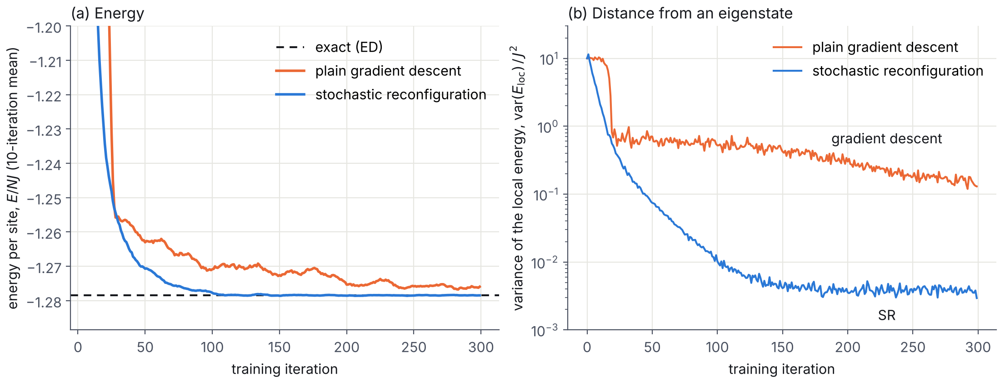
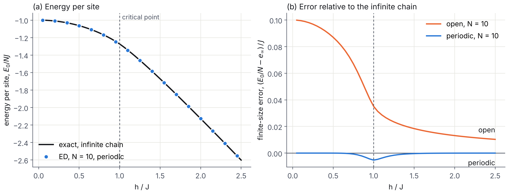
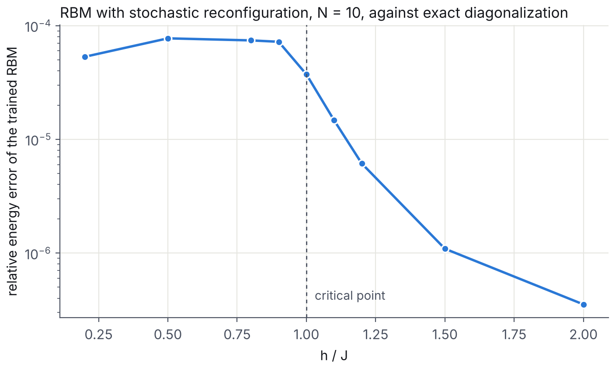

# Neural quantum states from scratch

A restricted Boltzmann machine wavefunction for the transverse-field Ising chain. 
NumPy specific

H = −J Σ σᶻᵢσᶻᵢ₊₁ − h Σ σˣᵢ, periodic boundaries, J = 1.

## Stages

| File | What it does | How it is checked |
|---|---|---|
| `ed.py` | Exact diagonalization for N ≤ 12 | Matches the exact Jordan–Wigner solution to 6 decimals |
| `vmc.py` | Metropolis sampler and local energy | Returns the exact energy, with zero variance, when given the exact ground state |
| `rbm.py` | RBM wavefunction, trained by gradient descent or stochastic reconfiguration (SR) | Exact energy and fidelity of the trained network, at N = 10 |
| `fast_vmc.py` | Vectorized sampler with incremental updates, for long chains | Local energies match `vmc.py` to 1e-13 |
| `step4.py` | Benchmark across h, and at N = 20 and 40 | ED at N = 10; exact Jordan–Wigner energy beyond that |

## Results at N = 10, h = 1 (the critical point)

| Training | Relative energy error | Fidelity with exact state | var(E_loc) |
|---|---|---|---|
| Plain gradient descent | 1.6 × 10⁻³ | 0.996 | 0.13 |
| Stochastic reconfiguration | 3.2 × 10⁻⁵ | 0.99994 | 0.003 |

120 parameters stand in for 1,024 amplitudes. Same network, same samples, 300 iterations each.



The variance of the local energy is zero only for an exact eigenstate, so panel (b) shows how far each
method is from the true ground state without needing the exact answer. Gradient descent also depends
strongly on its step size; SR gave errors between 3 and 8 × 10⁻⁵ across every step size I tried.

## Finite-size check from exact diagonalization



With periodic boundaries the error against the infinite chain is essentially zero, except at h = 1,
where the correlation length diverges. There, conformal field theory predicts a correction of
−πcv/(6N²) with central charge c = 1/2 and velocity v = 2J, which is −0.00524 at N = 10.
The measured value is −0.00525.

## Run

```
python ed.py          # checks against reference energies
python vmc.py         # sampler tests
python rbm.py sr      # train with SR (or: python rbm.py gd)
python step4.py      # scan over h, then N = 20 and 40 (a few minutes)
python fig1.py && python fig2.py && python fig3.py
```

## Across the phase diagram, and beyond exact diagonalization



At N = 10 the trained RBM stays within 10⁻⁴ of the exact energy for every h, with fidelity above 0.9997.
It is hardest in the ordered phase and at the critical point, and almost exact deep in the paramagnetic phase
(3.5 × 10⁻⁷ at h = 2), where the ground state is close to a product state.

At the critical point, beyond what exact diagonalization can store:

| N | Amplitudes | Exact E/N (Jordan–Wigner) | RBM E/N | Relative error |
|---|---|---|---|---|
| 20 | ~10⁶ | −1.274549 | −1.274375 ± 0.000052 | 1.4 × 10⁻⁴ |
| 40 | ~10¹² | −1.273567 | −1.273075 ± 0.000044 | 3.9 × 10⁻⁴ |

The error grows with N at a fixed network size (one hidden unit per spin) and a fixed training budget.
Translation symmetry and more hidden units are the obvious next steps.
