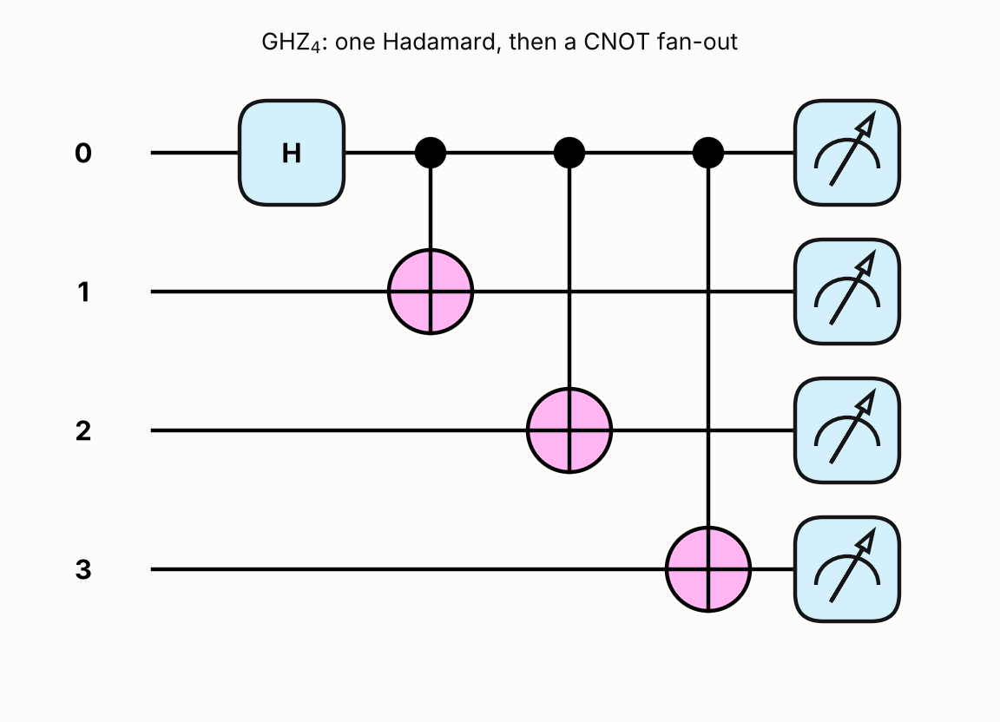
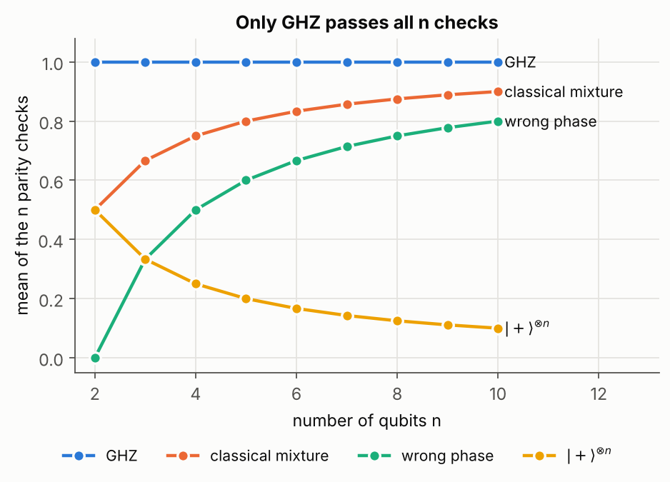

# 1. Certifying a GHZ state with parity checks

## The question

Prepare the n-qubit GHZ state (|00…0⟩ + |11…1⟩)/√2 and return n observables whose average is 1
for GHZ and below 1 for any other state. The catch is that hardware never hands you the state,
only expectation values of observables you chose. The grader also inspects the observables
themselves: they must be the global X parity X₀X₁⋯Xₙ₋₁ and the n − 1 neighbouring parities ZᵢZᵢ₊₁,
each a plain Pauli word with coefficient 1.

## The answer

```python
qp.Hadamard(wires=0)
for target in range(1, n):
    qp.CNOT(wires=[0, target])

checks = [qp.prod(*[qp.X(w) for w in range(n)])]
checks += [qp.Z(i) @ qp.Z(i + 1) for i in range(n - 1)]
```

The score is 1.0 at n = 3 and n = 5, the checks reduce to exactly the required Pauli words, and the
circuit holds one Hadamard and n − 1 CNOTs, nothing else.



## Explanation

**A Z-basis histogram is not enough.** A machine that flips a coin and prepares either |00…0⟩
or |11…1⟩ gives the same histogram as GHZ. Its density matrix has the same diagonal. The difference
lives entirely in the off-diagonal terms (the coherences), and Z measurements cannot see them.

**The X parity sees the coherence.** X⊗ⁿ flips every bit, so it swaps |00…0⟩ and |11…1⟩. Inside that
two-dimensional subspace, ⟨X⊗ⁿ⟩ = 2 Re ρ₀₀…₀,₁₁…₁. That is +1 for GHZ, 0 for the coin-flip mixture
and −1 for the wrong-phase state (|00…0⟩ − |11…1⟩)/√2.

**But the X parity alone is fooled.** The product state |+⟩⊗ⁿ is a +1 eigenstate of every Xᵢ, so it
scores a perfect X parity with no entanglement at all.

**Together they are enough.** Each ZᵢZᵢ₊₁ asks whether neighbours agree. If all n − 1 say yes, then by
chaining every qubit agrees with every other, so only |00…0⟩ and |11…1⟩ carry population. The X parity
then forces the + sign between them. The n checks commute, are independent, and are exactly the
stabilizer generators of GHZ, which is why a +1 on all of them fixes the state uniquely. Neighbouring
pairs are enough: any other pair ZᵢZⱼ is a product of neighbouring ones and adds nothing new.



The decoys land exactly on the closed forms: |+⟩⊗ⁿ scores 1/n, the mixture (n − 1)/n and the wrong
phase (n − 2)/n. All three get closer to 1 as n grows, which is a reminder that a high average is not
the same as a perfect one.

**Why one Hadamard, before the CNOTs.** The Hadamard on wire 0 creates the superposition, and each CNOT
copies the control's basis value onto one more wire, so n − 1 CNOTs reach every wire. Put the Hadamard
after the CNOTs and you only get |0…0⟩ with a |+⟩ on wire 0. Put a Hadamard on every wire and you get
the |+⟩⊗ⁿ decoy.

## Things that tripped me up in PennyLane

- `qp.prod` takes the operators as separate arguments, so a list needs unpacking with `*`.
- Building `qp.X` or `qp.Z` objects inside a QNode does not apply them as gates. `qp.prod` and `@`
  take their factors off the circuit queue. The check script confirms the tape holds only H and CNOTs.
- The function returns observables. The wrapper measures them, so returning `qp.expval(...)` would
  wrap them twice.

## Run

```
python solution.py    # both public cases, the Pauli words, the gate list, and all decoy scores
python figures.py
```

## What this does not show

- Everything here runs on an exact simulator, with no shots and no noise. On hardware each check is
  estimated from samples, and a score slightly below 1 has to be turned into a fidelity bound. That is
  a separate step I did not do.
- Only n checks are measured. Full state tomography would need exponentially many, and that saving
  is the whole point of the method.
