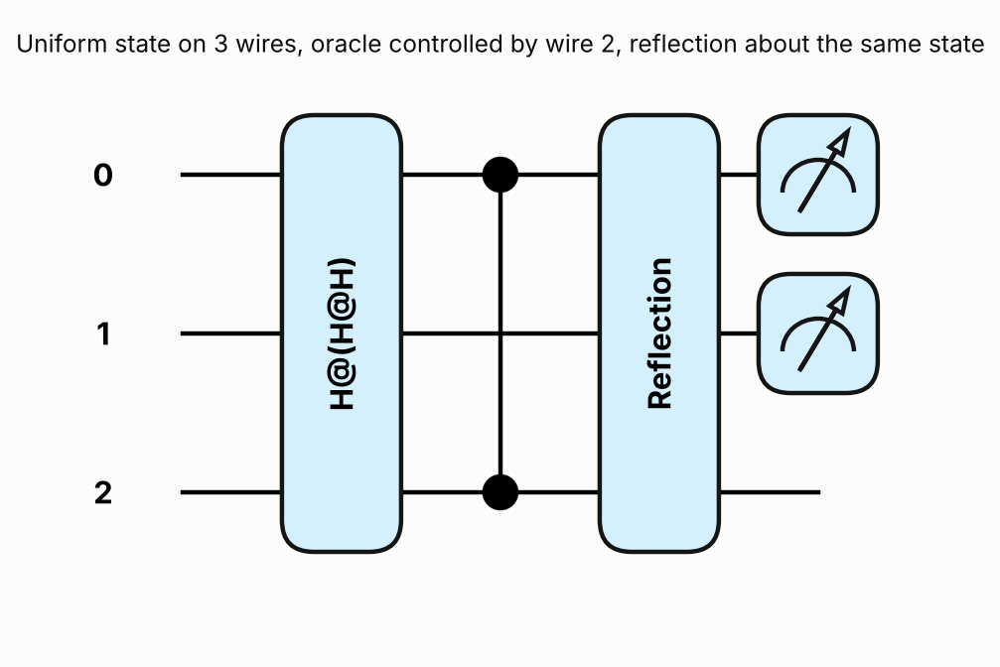
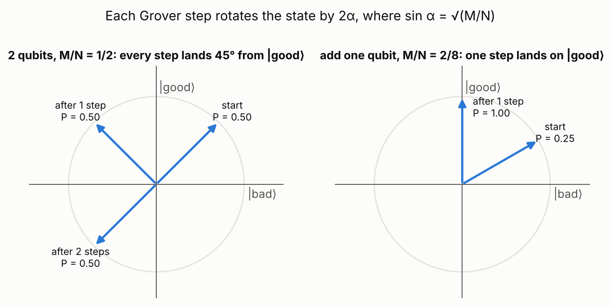
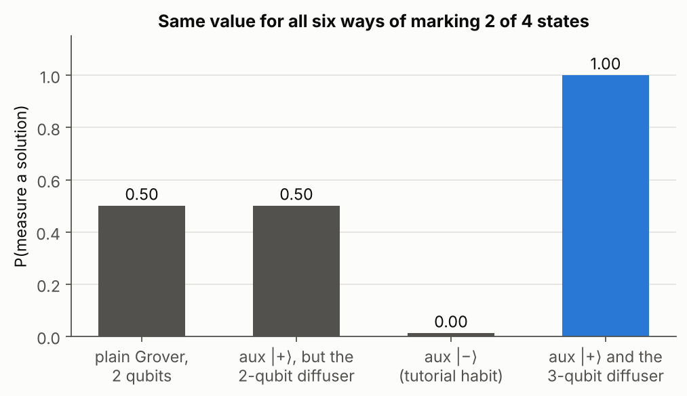

# 2. Grover search when half the list is marked

## The question

Two qubits, four basis states, and an oracle that marks two of them with a minus sign. You do not
know which two. Using one auxiliary qubit, one oracle call, one diffuser call and **a single shot**,
measure a solution every time. The grader runs 1000 random oracles, so "with high probability" is
not good enough: the success probability has to be exactly 1.

You are given three building blocks: `generator()` (Hadamards on wires 0 and 1), `oracle()` and
`diffuser(generator)`, which reflects about whatever state the generator prepares.

## The answer

Put the auxiliary qubit in |+⟩, let it **control** the oracle, and reflect about the new 3-qubit
uniform state. The core of what I submitted:

```python
@qp.prod
def groversolfunc():           # the given generator, plus a Hadamard on the auxiliary wire
    generator()
    qp.Hadamard(wires=2)

groversolfunc()                 # 3-qubit uniform state
qp.ctrl(oracle, control=2)()    # mark solutions only where the auxiliary qubit is |1>
diffuser(groversolfunc)         # reflect about the same state we started in
return qp.counts(wires=(0, 1))
```

It passes 1000 random single-shot runs, and the exact success probability is 1.000000000000 for
all six ways of marking two of the four states, including the case the grader never tests.



## Explanation

**Why half the list breaks Grover.** Split the state into |good⟩ (the solutions) and |bad⟩ (the
rest). The start state sits at an angle α from |bad⟩ with sin α = √(M/N), and every oracle plus
diffuser step rotates it by 2α. After k steps the success probability is sin²((2k + 1)α).
With M/N = 1/2, α = 45°, so the state visits 45°, 135°, 225°, …: always exactly 45° away from |good⟩.
Repeating the step never helps.



**A deeper reason: the oracle cannot tell a set from its complement.** The oracle for a set S is
O_S = I − 2P_S. For the complement, O_{Sᶜ} = I − 2(I − P_S) = −O_S. The two differ only by a global
phase. So any circuit that uses the oracle as it is behaves identically on S and on Sᶜ, and therefore
P(success on S) + P(success on Sᶜ) = 1. At M = N/2 both are valid problems, so no such circuit can
reach 1 on both. You can see this in the grader's own oracles: case 0 is Z on wire 0, and case 1 is
X·Z·X = −Z on wire 0, which marks the complementary pair.

**The fix: control the oracle.** Controlling an operator turns its global phase into a relative phase:
C(−U) = (Z ⊗ I)·C(U). With the auxiliary qubit in |+⟩, that extra Z flips it to |−⟩, which a
measurement can see. The control also changes the counting. Now N = 8 and only |x⟩|1⟩ with x a solution
is marked, so M = 2 and M/N = 1/4, which gives α = 30°. One step lands at 3α = 90°, exactly on |good⟩.
I found the target by running the formula backwards: one exact step needs (2·1 + 1)α = 90°, so α = 30°
and M/N = sin²30° = 1/4.

**The diffuser has to match the new start state.** Grover's rotation only works if the diffuser
reflects about the state you started in. That is now H⊗H⊗H|000⟩, so I passed `diffuser` a generator
that includes the auxiliary wire. Reusing the given generator inside it keeps the preparation and the
reflection axis identical by construction.



The figure shows why each choice matters. Keep the 2-qubit diffuser and you are stuck at 0.5 again.
Put the auxiliary qubit in |−⟩, a habit from phase-kickback oracles, and you find a non-solution
every time. Leave it in |0⟩ and the oracle never acts. Leave it in |1⟩ and the oracle always acts,
which is the uncontrolled case again.

## Things that tripped me up

- Defining a function is not calling it. `def preppytime():` stores the gates; nothing happens until
  `preppytime()` runs.
- `qp.ctrl(oracle, control=2)` needs the function, not `oracle()`, which would apply it uncontrolled.
- `diffuser` calls its argument internally, so it gets `groversolfunc`, not `groversolfunc()`.
- Two ways the local grader can pass a broken circuit: counts over all three wires (the keys never match
  the grader's two-bit strings), and a circuit that can never output 01 or 10, which my first GHZ-style
  attempt did. The grader only ever draws three of its four oracles, and none of them marks {01, 10}.
  The check script tests all six pairs.

## Run

```
python solution.py    # 1000 single-shot runs plus exact probabilities for all six oracles
python figures.py
```

## What this does not show

- This trick needs M/N = 1/2 exactly. With an unknown number of solutions you need other tools, such
  as fixed-point or exact amplitude amplification with tuned phases.
- It is exact only on a noiseless simulator. On hardware, one shot would succeed with probability
  slightly below 1.
