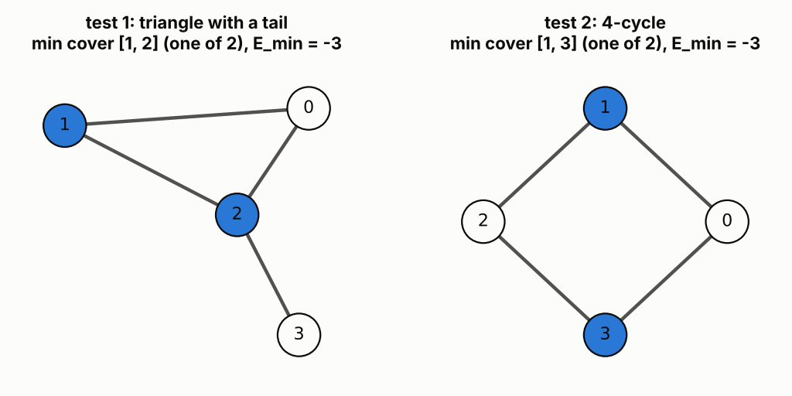
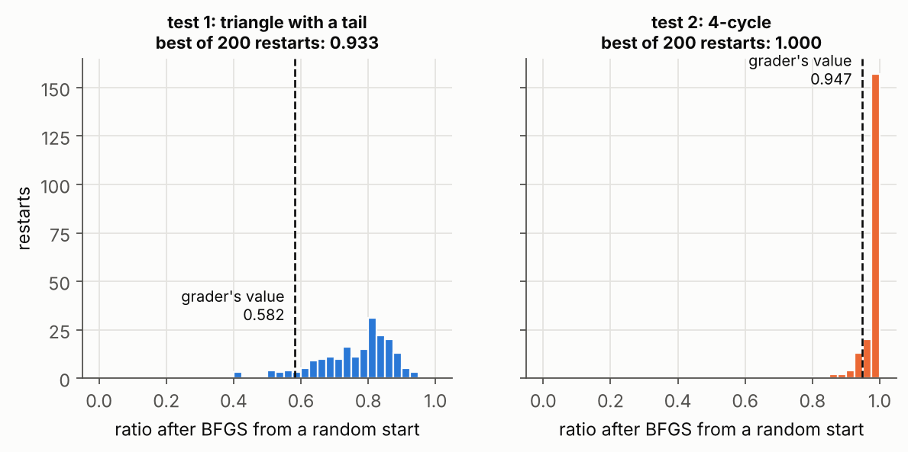
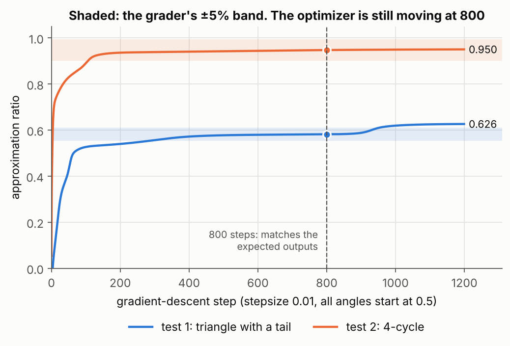

# 3. QAOA for minimum vertex cover, and why the answer depends on the optimizer

## The question

Given a graph as a list of edges, find a minimum vertex cover with depth-4 QAOA: the smallest set of
vertices such that every edge touches at least one of them. Build the cost Hamiltonian

H_cost = ¾ Σ₍ᵢ,ⱼ₎∈edges (ZᵢZⱼ + Zᵢ + Zⱼ) − Σᵥ Zᵥ

and the mixer H_mix = Σᵥ Xᵥ, optimize the 8 QAOA angles, and return the approximation ratio

r = (minimum ⟨H_cost⟩ found by QAOA) / (true minimum eigenvalue of H_cost),

to within 5% of the reference on hidden graphs.

## The answer

| Graph | My output | Expected | Relative error |
|---|---|---|---|
| triangle with a tail | 0.5816092358 | 0.58160924 | 7 × 10⁻⁹ |
| 4-cycle | 0.9474673397 | 0.94746734 | 3 × 10⁻¹⁰ |

The physics part is standard QAOA. The interesting part was the number 800: the expected outputs are
**not** the best depth-4 QAOA can do, and the solution only passes because it reproduces the
reference's exact optimization routine.



## Explanation

**From cover to Hamiltonian.** Give each vertex a bit xᵥ (1 means in the cover) and write the classical
cost C = Σᵥ xᵥ + P·Σ₍ᵢ,ⱼ₎ (1 − xᵢ)(1 − xⱼ). The first term counts the cover, and the second charges P for
every uncovered edge. Substituting xᵥ = (1 − Zᵥ)/2 gives

2C = n + ¾|E| − Σᵥ Zᵥ + ¾ Σ₍ᵢ,ⱼ₎ (ZᵢZⱼ + Zᵢ + Zⱼ)   with P = 3/2,

which is the challenge's H_cost plus a constant. So H_cost is diagonal, its ground state is a minimum
cover, and its smallest eigenvalue is the optimal cost. Per edge, ZᵢZⱼ + Zᵢ + Zⱼ is +3 if neither end is
in the cover and −1 otherwise, so a valid cover of size k has energy −¾|E| + 2k − n. Both test graphs
have minimum covers of size 2, so E_min = −3 for both.

**Why ¾.** Dropping a vertex saves 2 in energy. Leaving an edge uncovered costs ¾·(3 − (−1)) = 3. Since
3 > 2, it never pays to break the cover. With a coefficient of ¼ the penalty would be 1, and an
invalid set could become the ground state.

**The QAOA state.** Start in |+⟩⊗ⁿ, then apply four rounds of e^(−iγₖH_cost) followed by e^(−iαₖH_mix).
The cost layer is diagonal, so on its own it only adds phases and changes no measurement probability.
The mixer rotates each qubit about X, so those cost-dependent phases interfere and push amplitude
towards cheap bitstrings. All the terms of H_cost commute, so e^(−iγH_cost) splits exactly into IsingZZ
and RZ gates with no Trotter error, but the factor of 2 in RZ(2γc) = e^(−iγcZ) is easy to get wrong, and it
changes the answer here. I used PennyLane's `qaoa.cost_layer` and `qaoa.mixer_layer` to avoid that.

**The variational principle bounds the ratio.** ⟨H_cost⟩ ≥ E_min for every state, so r ≤ 1, with equality
only at the ground state. With bad angles ⟨H_cost⟩ can even be positive, which gives a negative r.

**The number 800.** My first instinct was to optimize properly. That fails. With 200 random restarts,
depth-4 QAOA reaches 0.933 on test 1 and 1.000 on test 2, far above the expected 0.582 and 0.947. The
expected values are a **local minimum** that one particular run happens to sit in.



So I tracked the ratio after every step for a few standard optimizers. Plain gradient descent, all
angles starting at 0.5 (PennyLane's QAOA demo settings), step size 0.01, matched **both** expected
outputs to eight or more significant figures at exactly 800 steps. Two different graphs agreeing to that
precision is not a coincidence, so that is the reference routine. It is also not converged: by 1000
steps test 1 has moved to 0.619, which is outside the 5% band.



This is the part I find most worth remembering. The approximation ratio here describes one
optimization run, not how good depth-4 QAOA is. The landscape is not convex, and the start point,
optimizer, step size and step count together decide which minimum you end in.

## Things that tripped me up

- Collect the vertices from the edges rather than taking the largest label plus one. A gap in the
  labels would otherwise add a fake vertex, and its −Z term changes both the numerator and E_min.
  The wires are the vertex labels themselves, so no index mapping is needed.
- `set()` is an empty set. `{}` is an empty dictionary.
- ZᵢZⱼ is `qp.Z(i) @ qp.Z(j)`. `*` between two operators is a TypeError.
- The ¾ applies to the edge terms only. Scaling the finished total would also scale the −Z terms.
- The mixer is +ΣX, nothing more. A minus sign flips every α and sends the optimizer down a
  different path.
- With two parameter arrays, `alpha, beta = optimizer.step(f, alpha, beta)` has to unpack in the
  signature's order. Swap them and there is no error, just a wrong answer.

## Run

```
python solution.py    # both public cases, plus a graph with a gap in its labels (about 1 minute)
python figures.py     # about 2 minutes
```

## What this does not show

- I matched the reference routine from two public data points. The match to eight digits makes me
  confident, but I never saw the reference code, and hidden graphs with unusual labels could still
  differ.
- Everything is exact statevector simulation. With shots, each gradient would be noisy and the path
  would change again.
