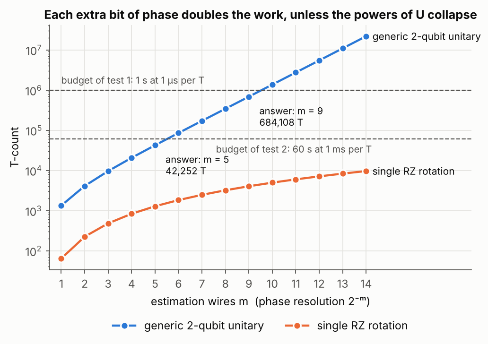

# 4. How much phase estimation fits in a time budget

## The question

Resource estimation usually runs forwards: pick an algorithm, count its T gates, multiply by the time
per T gate. This challenge runs it backwards. Given a logical T-gate time and a wall-clock budget, find
the largest textbook quantum phase estimation that fits, for a generic two-qubit base unitary, compiled
to Clifford+T with single-qubit rotations synthesized to precision 10⁻⁶. Return the number of estimation
wires m, the resolution 2⁻ᵐ it buys, and the T-count, which must match PennyLane's estimator exactly.
The estimator has to be called at least twice, so the answer comes from comparing sizes.

## The answer

Scan m upwards and stop at the first size that overruns the budget:

```python
for m in range(1, max_estimation_wires + 1):
    resources = qre.estimate(qre.QPE(qre.QubitUnitary(num_wires=2), num_estimation_wires=m),
                             gate_set=GATE_SET, config=config)
    t_count = int(resources.gate_counts.get("T", 0))
    if t_count * t_gate_seconds > budget_seconds:
        break
    best = (m, 2.0 ** -m, t_count)
```

| T-gate time | Budget | Answer |
|---|---|---|
| 1 µs | 1 s (10⁶ T gates) | m = 9, resolution 0.001953125, 684,108 T |
| 1 ms | 60 s (60,000 T gates) | m = 5, resolution 0.03125, 42,252 T |

## Explanation

**One bit costs a doubling.** With m estimation wires, QPE applies controlled powers U, U², U⁴, …,
U^(2^(m−1)), which is 2ᵐ − 1 applications of controlled-U in total. A generic two-qubit unitary has no
structure that lets those powers shrink, so each extra wire doubles the work. The measured ratio between
neighbouring sizes settles at 2.00 from m = 7 on. That monotonic growth is also why stopping at the first
overrun is safe: nothing larger can fit.

**Unless the powers collapse.** For a single rotation, RZ(θ)^(2ᵏ) = RZ(2ᵏθ), so every power costs the same
as one rotation. The controlled-powers block then grows only linearly, and what is left is mostly the
inverse QFT. At m = 14 that is 9,632 T gates, against 21.8 million for the generic unitary.



**Why the trade is still good.** One more bit of phase for twice the runtime is a far better deal than
sampling, where one more decimal digit costs a hundred times more shots.

## Run

```
python solution.py    # both public cases
python figures.py
```

## What this does not show

- The T-count is the only cost here. Real estimates also count logical qubits, magic-state factories
  and routing, and the rotation precision would be chosen from the target error rather than fixed.
- I only looked at textbook QPE. Iterative or Bayesian variants trade estimation wires for repetitions,
  and would move these numbers a lot.
