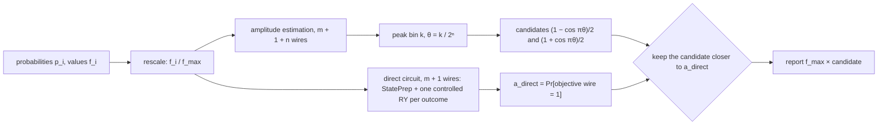
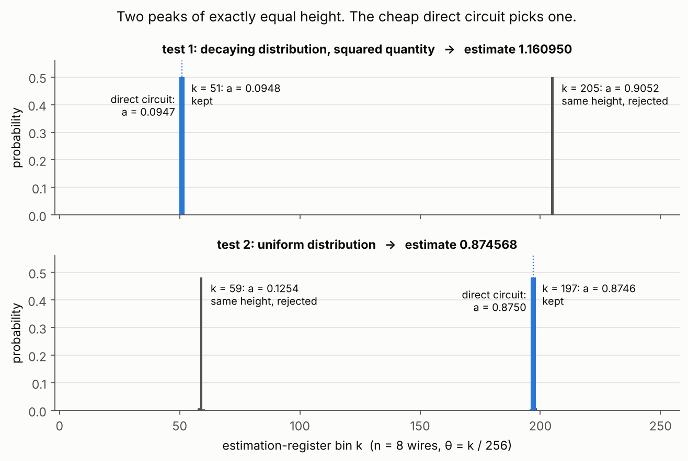

# 5. Breaking the tie in amplitude estimation

## The question

Estimate the mean E[f(X)] = Σᵢ pᵢfᵢ of a non-negative quantity over a discrete distribution, using
quantum Monte Carlo: load the distribution onto m data wires, rotate one objective wire so that
outcome i puts amplitude √(fᵢ/f_max) on |1⟩, and run amplitude estimation with n estimation wires.
The catch is that amplitude estimation returns two candidates that are equally consistent with the
measurement, and the challenge is to pick the right one. The answer must match the reference estimate
to 10⁻⁹, so the exact mean Σᵢ pᵢfᵢ does not pass: the estimate is quantized by the register.

## The answer



| Case | My estimate | Expected | Exact mean |
|---|---|---|---|
| decaying distribution, squared quantity | 1.160949660702857 | 1.160949660702857 | 1.159917 |
| uniform distribution | 0.8745681972617296 | 0.8745681972617296 | 0.875000 |

Both match to the last digit. The first case keeps the smaller candidate and the second keeps the
larger one, which is exactly where the recipe in PennyLane's own documentation goes wrong.

## Explanation

**Why two answers come back.** Amplitude estimation runs phase estimation on a Grover-like operator Q.
Inside its two-dimensional invariant subspace Q is a rotation, with eigenvalues e^(±2πiθ). The prepared
state is an equal superposition of the two eigenvectors, so the register shows two peaks of exactly
equal height, at k and at 2ⁿ − k. The mirror bin has phase 1 − θ, and cos(π(1 − θ)) = −cos(πθ), so the
two bins map to a and 1 − a. More estimation wires sharpen both peaks equally, so this is structural,
not a resolution problem.



**What breaks the tie.** Any independent estimate of a that is closer than half the gap |1 − 2a| will do.
The cheapest one is the encoding itself, measured directly: StatePrep for the distribution, one
multi-controlled RY per outcome, then read the objective wire. That gives a outright. It is ordinary
sampling, so on hardware it would cost about 1/ε² shots for accuracy ε, while amplitude estimation reaches
1/ε. Here it only needs to tell apart two candidates that are at least 0.13 apart, so a coarse number is
enough, and it is never the number I report.

**Why the documentation recipe fails.** It takes the argmax over only the lower half of the register,
which always picks the smaller candidate. That is right for its own example and wrong for the second
public case, where it would return 0.125432 instead of 0.874568.

**The numbers by hand, for the uniform case.** f_max = 1, so a = 0.875. Then θ = arccos(1 − 2a)/π =
0.769947, and 2⁸θ = 197.106, so the tallest bin is k = 197, with its mirror at 59. The candidates are 0.125432
and 0.874568. The register can only report the integer 197, and that rounding is the entire gap
between 0.874568 and the exact 0.875.

## Things that tripped me up

- StatePrep takes amplitudes, so the input is √pᵢ, not pᵢ.
- The function handed to `QuantumMonteCarlo` must return the rescaled fᵢ/f_max, not the raw values.
- `target_wires` is the m data wires plus the objective wire, m + 1 in all.
- In the control values, wire 0 holds the most significant bit of i, matching StatePrep's ordering.
- My first version returned `f_rescaled * winner`, an array times a number. The fix was the scalar
  `f_given * winner`.

## Run

```
python solution.py    # both public cases
python figures.py
```

## What this does not show

- No shots anywhere. On hardware both circuits are sampled, and the direct estimate has to be good
  enough to separate the candidates with high probability, which sets its shot budget.
- When a is close to 0.5 the two candidates merge and the tie-breaker needs more and more shots. None of
  the test cases go there.
