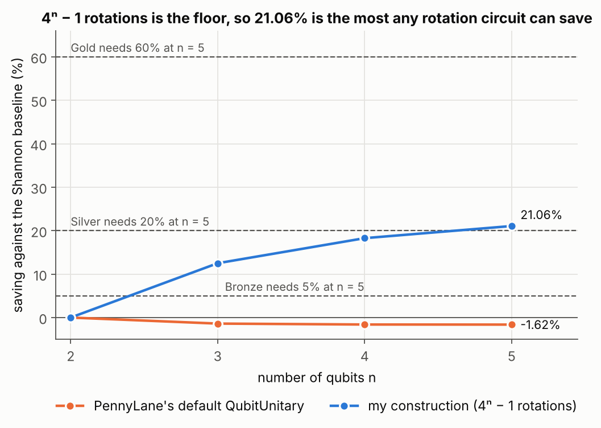
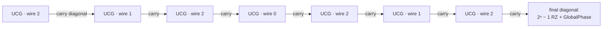

# 6. Unitary synthesis below the Shannon decomposition

## The question

Take a Haar-random unitary on n = 2, 3, 4 or 5 qubits and build a circuit for it, global phase included,
to 10⁻⁸ in every matrix entry. The circuit is decomposed into RX, RY, RZ, T, S, H, X, Y, Z, CNOT and
GlobalPhase, and charged in T-gate equivalents:

| Gate | Cost |
|---|---|
| RX, RY, RZ, any angle | 44 |
| T | 1 |
| Cliffords, CNOT, GlobalPhase | 0 |

Every auxiliary wire doubles the whole cost. The baseline is the Shannon decomposition of Shende,
Bullock and Markov, which costs 44·(21/16·4ⁿ − 3·2ⁿ⁻¹): 13,728 at four qubits. Your cost must stay at or
below the baseline at every size, your saving must never shrink as n grows, and the saving at five
qubits decides the grade: 5% for Bronze, 20% for Silver, 60% for Gold. These were three separate
challenges with the same statement.

## The answer

One construction, submitted to both Bronze and Silver:

| n | My cost | Baseline | Saving | Rotations |
|---|---|---|---|---|
| 2 | 660 | 660 | 0.00% | 15 |
| 3 | 2,772 | 3,168 | 12.50% | 63 |
| 4 | 11,220 | 13,728 | 18.27% | 255 |
| 5 | 45,012 | 57,024 | **21.06%** | 1023 |

That is Silver, with errors around 10⁻¹⁵ and no auxiliary wires. The rotation count is exactly 4ⁿ − 1
at every size, which turns out to be the floor for any circuit built from rotations. Gold is a different
story, and it became the research part of this project: [7. How many T gates does a unitary need?](../07-how-many-t-gates/)



## Explanation

**Count the parameters first.** A unitary on n qubits has 4ⁿ real parameters, one of which is the
global phase, and GlobalPhase is free. Every rotation contributes exactly one continuous parameter, and
every other gate in the set contributes none. So any exact rotation circuit needs at least 4ⁿ − 1
rotations. At five qubits that is 1023 rotations, a cost of 45,012 and a saving of 21.06%. My
construction sits exactly on that floor.

**Split the unitary into uniformly controlled gates.** The cosine-sine decomposition splits a unitary
into two block-diagonal halves around a layer of RY rotations: U = (L₀ ⊕ L₁)·CS·(R₀ ⊕ R₁). Instead of
turning the blocks back into separate smaller unitaries, I keep splitting blocks of blocks. In the end
U becomes a time-ordered sequence of exactly 2ⁿ − 1 **uniformly controlled gates** (UCGs): a 2×2 unitary
on one target wire, a different one for every state of all the other wires. For n = 3 the targets come
out as 2, 1, 2, 0, 2, 1, 2.



**Implement each one only up to a diagonal.** For each control state, write the 2×2 block as
e^(iφ)·RZ(a)·RY(b)·RZ(c). The RZ(c) parts form one multiplexed RZ, and the RY(b) parts form one
multiplexed RY, at 2ⁿ⁻¹ rotations each. The leftover e^(iφ)·RZ(a) is diagonal, so I do not build it at all.
I carry it forward and multiply it into the next UCG. That is free, because a diagonal matrix is block
diagonal for any choice of target, so the next UCG stays a UCG. A general UCG would cost 4·2ⁿ⁻¹ rotations,
and done this way it costs 2·2ⁿ⁻¹.

**Multiplexers out of CNOTs.** A multiplexed rotation with k controls takes 2ᵏ rotations and some CNOTs:
split the angles into even and odd halves, apply the multiplexer of the averages, a CNOT, the
multiplexer of the half-differences, and another CNOT. This works because X·R(θ)·X = R(−θ) for both RY
and RZ, so the CNOTs flip the sign of the second half exactly when the last control is 1. CNOTs are free
in this cost model, so I never minimized them.

**Then add it up.** (2ⁿ − 1) UCGs at 2ⁿ rotations each, plus 2ⁿ − 1 rotations for the final diagonal:

(2ⁿ − 1)·2ⁿ + (2ⁿ − 1) = (2ⁿ − 1)(2ⁿ + 1) = **4ⁿ − 1**.

The challenge's hint mentions that PennyLane's default `QubitUnitary` decomposition sits just over the
baseline, which matches what I measured: 1.4 to 1.6% worse. My first plan, a Shannon decomposition with
merged RZ gates, would have reached about 11%. The multiplexed version turned out to be both simpler and
better.

## Things that tripped me up

- PennyLane's `one_qubit_decomposition` returns gate objects, not angles, and calling it inside a
  circuit queues those gates. I wrote my own six-line ZYZ instead.
- Merge the carry into the next gate *before* overwriting it. The other order breaks the matrix completely.
- The carried diagonal acts first in time, so it multiplies on the right: `g @ diag(...)`.
- The challenge platform only accepted code inside the body of `submission_circ`, so in the submitted
  version the helpers were nested functions. Here they are top level, so other scripts can reuse them.
- `cs_decomposition` was a helper in the challenge template. `synthesis_tools.py` rebuilds it on
  `scipy.linalg.cossin`, which uses the same convention, along with my own version of the cost model.

## Run

```
python solution.py    # 2 to 5 qubits, three random unitaries each: cost, rotations, CNOTs, error
python figures.py
```

## What this does not show

- CNOTs cost nothing here, and I spent them freely: 1912 at five qubits. The optimized Shannon
  decomposition needs (23/48)·4ⁿ − (3/2)·2ⁿ + 4/3 CNOTs, about 444 at five qubits. On a real
  fault-tolerant machine, two-qubit gates cost time.
- I tested three random unitaries per size, up to five qubits. The recursion is numerically clean
  there, but I have not checked how the errors grow at larger n.
