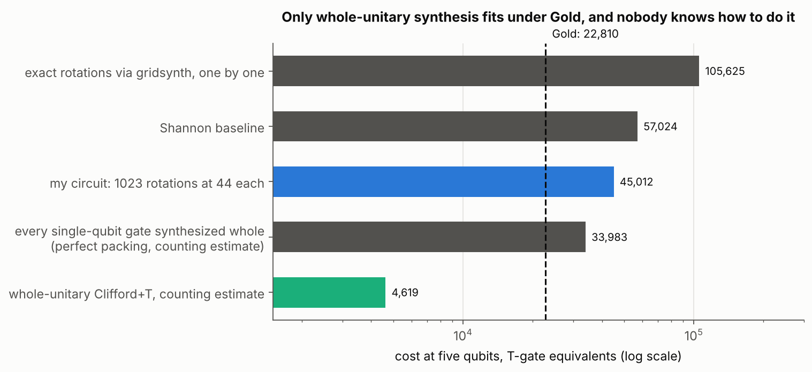
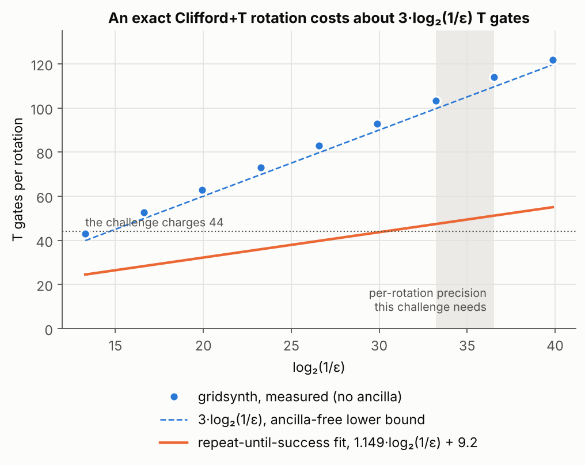
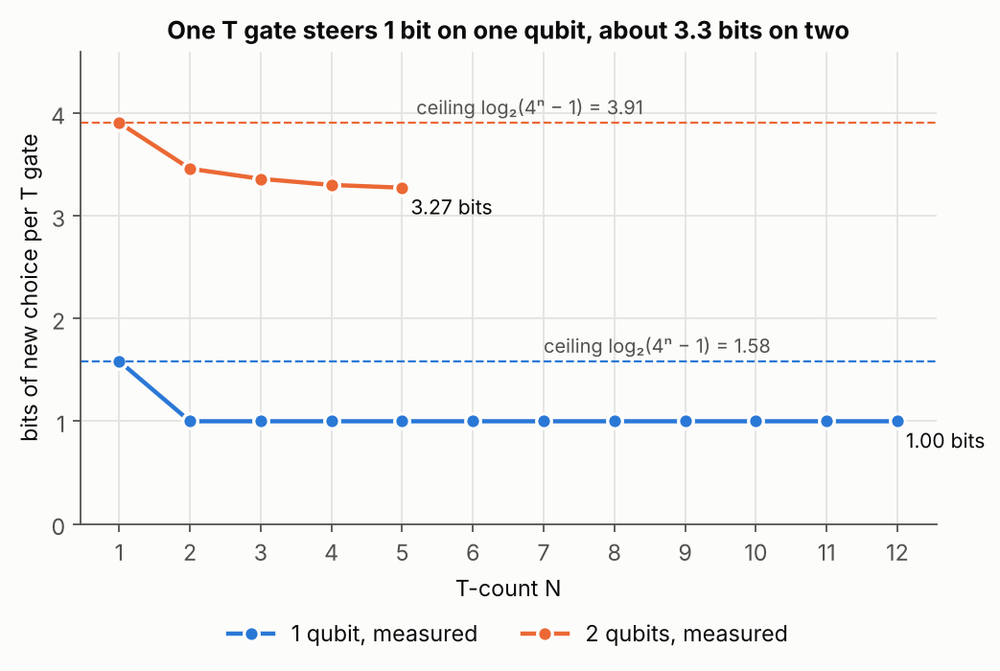

# 7. How many T gates does a unitary need?

The Gold version of [the synthesis challenge](../06-unitary-synthesis/) asked for a **60%** saving against
the Shannon decomposition at five qubits. My Silver circuit saves 21.06%. This folder is my attempt to
find out whether 60% is possible at all, and what it would take. It started as an open-ended question
after the competition and ended as a small study of what a T gate is actually worth.

## The question

Under the challenge's cost model (44 per rotation, 1 per T gate, Cliffords and CNOTs free), can any
exact circuit for a Haar-random 5-qubit unitary cost at most 22,810? That is 40% of the 57,024 baseline.

## The short answer

- **With rotation gates, no.** A random unitary needs at least 4ⁿ − 1 rotations, my circuit already uses
  exactly that many, and 1023 × 44 = 45,012 is a 21.06% saving. That is the ceiling.
- **Replacing rotations with exact Clifford+T sequences makes it worse.** At the precision this problem
  needs, each one costs about 100 to 115 T gates, not 44.
- **Repeat-until-success circuits get to about 44, but they need measurement.** This grader has no
  measurement, so they do not fit.
- **Counting says Gold is not forbidden.** Circuits built directly from T and Clifford gates, a few
  thousand T gates long, should exist. Nobody knows how to find them.



## 1. The rotation floor

A unitary on n qubits has 4ⁿ real parameters, and the global phase is free. Each rotation carries exactly
one continuous parameter, and nothing else in the gate set carries any. A fixed circuit layout with r
rotations therefore reaches at most an (r + 1)-dimensional family of unitaries. If r < 4ⁿ − 1, that
family has measure zero inside the 4ⁿ-dimensional unitary group, so a Haar-random U lands in it with
probability zero. Within one layout, the tolerance of 10⁻⁸ does not rescue it. Changing the layout adds
discrete choices, though, and spending those choices instead of angles is exactly what sections 4 and 5
are about.

I checked that my circuit has no wasted angle. Treating its rotation angles as free variables,
`rotation_floor.py` computes the Jacobian of U with respect to them:

| n | Angles + phase | Jacobian rank | With one angle frozen |
|---|---|---|---|
| 2 | 15 + 1 | 16 of 16 | 15 |
| 3 | 63 + 1 | 64 of 64 | 63 |

Every angle moves U in an independent direction, and freezing any one of them leaves a lower-dimensional
family. 4ⁿ − 1 is the floor, and the construction sits on it.

## 2. One rotation as an exact Clifford+T sequence

T costs 1 and a rotation costs 44, so the obvious idea is to write rotations out in T gates myself. The
standard tool is gridsynth (Ross and Selinger), which is optimal for single Z rotations without ancillas.



The measured counts sit right on 3·log₂(1/ε). The challenge needs the whole 32 × 32 matrix to 10⁻⁸ across
about 1000 rotations, so each rotation needs roughly 10⁻¹⁰ to 10⁻¹¹, which costs **100 to 115 T gates**. That is
more than double the 44 the challenge charges. Every rotation I replace makes the circuit more expensive.

The data also hides a useful fact. A Z rotation is one parameter, but costs about as many T gates as a
whole single-qubit unitary, which is three parameters. Section 4 shows why. If every parameter could sit
inside a single-qubit gate synthesized whole, the cost would drop to about log₂(1/ε) T per parameter:
about 34,000 at five qubits, a 40% saving. That is still above Gold, and it assumes a perfect packing I
do not know how to build.

## 3. Why repeat-until-success does not fit

Bocharov, Roetteler and Svore beat the ancilla-free bound with repeat-until-success circuits: add one
ancilla, measure it, and on failure undo the damage and try again. Their fitted average is
1.149·log₂(1/ε) + 9.2 T gates, which is **43.6 at ε = 10⁻⁹**. That paper is exactly where the challenge's
price of 44 comes from, so using it can at best match the cost model. It also cannot run here. The grader
checks one fixed unitary and keeps only the branch where the ancilla is back in |0⟩. A single attempt
succeeds with probability p < 1, so that branch has norm √p and fails the accuracy check. And the extra
wire doubles the cost anyway.

## 4. Counting Clifford+T circuits

So the only way under Gold is to stop thinking in rotations at all, and build the whole unitary out of T
and Clifford gates. Whether that can be cheap depends on one number: how much genuinely new choice each
T gate adds.

`clifford_t_counting.py` counts it. Operators that differ by a Clifford on the right are the same
"thing you can reach", so it counts cosets gC by exact T-count. Two cosets are equal exactly when
gPg† and g′Pg′† give the same set of Paulis up to sign, which makes a fast canonical key. A new T gate
only matters modulo the Cliffords D for which T†DT is still Clifford. Those are the Cliffords that send
Z₀ to ±Z₀, so the number of genuinely different choices per T gate is capped by the number of Paulis Z₀
can be sent to: 4ⁿ − 1.

I checked the method on one qubit first. There the answer is known (Matsumoto and Amano):
3·2ᴺ⁻¹ cosets at T-count N, which is exactly one bit per T gate. The script reproduces it to N = 12. Then
two qubits:

| T-count | 1 | 2 | 3 | 4 | 5 |
|---|---|---|---|---|---|
| new cosets | 15 | 165 | 1,695 | 16,710 | 161,670 |
| growth per T | ×15.0 | ×11.0 | ×10.3 | ×9.9 | ×9.7 |
| bits per T | 3.91 | 3.46 | 3.36 | 3.30 | 3.27 |

The Clifford group comes out at 11,520 elements, its known size. On two qubits, one T gate steers about
**3.3 bits**, against 1 bit on one qubit.



## 5. What the counting allows

Getting within ε of every unitary in a D-dimensional space takes about (1/ε)^D distinct circuits, which is
D·log₂(1/ε) bits. Dividing by the bits per T gate gives a rough lower bound on the T-count
(`bounds.py`; constant factors are ignored, so these are scale estimates):

| | Counting estimate | Rotations at 44 | gridsynth, one rotation at a time |
|---|---|---|---|
| 2 qubits, ε = 10⁻⁸ | ~118 T | 660 | 1,245 |
| 2 qubits, ε = 10⁻¹⁰ | ~148 T | 660 | 1,549 |
| 5 qubits, ε = 10⁻⁸ to 10⁻¹⁰ | ~2,700 to 4,600 T | 45,012 | ~106,000 to 117,000* |

\* with each of the 1023 rotations at 10⁻¹⁰ to 10⁻¹¹, which is what the overall 10⁻⁸ requires.

At five qubits the low end uses the hard ceiling of log₂(4⁵ − 1) = 10 bits per T, and the high end uses the
efficiency measured at one and two qubits (73% of the ceiling). Either way it sits far below Gold's 22,810.
Gold allows 22.3 T per parameter, and counting says a few T per parameter might be enough.

**A correction to my own first guess.** During the competition I estimated that each T gate could carry
log₂|Clifford₅| ≈ 64 bits, because there are so many 5-qubit Cliffords to put between T gates. That gave
"a few hundred T gates". It was wrong. Most of that Clifford freedom is redundant, and the real ceiling is
log₂(4ⁿ − 1). The conclusion survived, but the numbers moved by a factor of ten.

## 6. Why nobody can build it yet

The circuits exist, and finding them is the problem. At 150 T gates there are around 10¹⁵⁰ two-qubit
candidates, so searching is hopeless. One qubit escapes the search through number theory: every
Clifford+T matrix has entries in the ring ℤ[1/√2, i], gridsynth solves for a nearby element of that ring
directly, and exact synthesis (Giles and Selinger) turns any unitary over that ring into a circuit,
sometimes with one ancilla. For
many qubits the exact-synthesis half still works. The missing half is finding a nearby unitary over that
ring with small entries, which becomes a lattice problem in about a thousand real dimensions at five
qubits. Nobody knows how to solve that well.

## What I would try next

Two qubits first, where the gap is clean: rotations cost 660 and counting says ~120 to 150. Approximate a
random 2-qubit unitary over ℤ[1/√2, i] with lattice reduction, run exact synthesis, and measure the T-count.
Landing anywhere between 150 and 660 would be interesting. Landing above 660 would show exactly where the
difficulty is.

## Run

```
python gridsynth_tcounts.py     # section 2, writes gridsynth_tcounts.json (needs pygridsynth)
python clifford_t_counting.py   # section 4, writes clifford_t_counting.json (about 15 s)
python rotation_floor.py        # section 1
python bounds.py                # section 5
python figures.py
```

## What this does not show

- The counting bounds ignore constant factors and only estimate the scale. At five qubits they also
  extrapolate the efficiency measured at one and two qubits.
- This kind of counting is not new. The one-qubit result is Matsumoto and Amano's, and Clifford+T structure
  on two qubits has been studied in more depth by others. I did it to see the numbers myself and to check the
  method against a known answer.
- I did not build a whole-unitary synthesizer, so the question stays open here. Everything above says
  where the answer has to live, not that it can be reached.

## References

- V. V. Shende, S. S. Bullock, I. L. Markov, [Synthesis of quantum logic circuits](https://arxiv.org/abs/quant-ph/0406176) (the baseline)
- M. Möttönen, J. J. Vartiainen, V. Bergholm, M. M. Salomaa, [Quantum circuits for general multiqubit gates](https://arxiv.org/abs/quant-ph/0404089) (uniformly controlled rotations)
- A. Bocharov, M. Roetteler, K. M. Svore, [Efficient synthesis of universal repeat-until-success circuits](https://arxiv.org/abs/1404.5320)
- N. J. Ross, P. Selinger, [Optimal ancilla-free Clifford+T approximation of z-rotations](https://arxiv.org/abs/1403.2975) (gridsynth)
- B. Giles, P. Selinger, [Exact synthesis of multiqubit Clifford+T circuits](https://arxiv.org/abs/1212.0506)
- K. Matsumoto, K. Amano, [Representation of quantum circuits with Clifford and π/8 gates](https://arxiv.org/abs/0806.3834)
