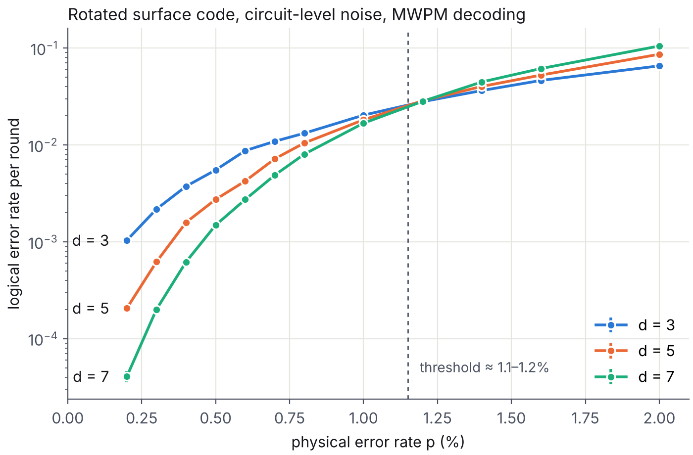

# Surface-code decoding: from simulation to FPGA logic

I wanted to understand quantum error correction as an engineering problem, not just as theory.
A code only protects information if its syndromes are decoded correctly and fast enough, on real
hardware. This repo goes through that pipeline in three steps, and checks every step against
something exact.

## 1. Threshold of the rotated surface code (`surface_code/`)

Stim builds memory experiments for the rotated surface code at distances 3, 5 and 7, with d rounds of
syndrome extraction and uniform circuit-level depolarizing noise of strength p on every gate, reset,
measurement and idle data qubit. PyMatching decodes them with minimum-weight perfect matching.



- The curves cross at p ≈ 1.1–1.2%. Below that, a larger code is better; above it, worse.
- At p = 0.2%, each step d → d + 2 lowers the logical error rate per round by a factor of about 5
  (1.0e-3 → 2.1e-4 → 4.1e-5).
- Each point uses up to 200,000 shots; error bars are binomial.

```
python surface_code/threshold.py       # about 10 s
python surface_code/plot_threshold.py
```

## 2. My own decoder, checked against PyMatching (`lut/`)

For distance 3 I wrote a lookup-table decoder: for each of the 16 possible syndromes of each check
type, it stores a minimum-weight correction. Under code-capacity noise (errors on data qubits only,
perfect measurements) I compared it with PyMatching on all 512 error patterns, for X and Z errors:

- Both decoders fail on exactly the same patterns.
- Every single-qubit error is corrected. 18 of the 36 two-qubit errors cause a logical error,
  so the exact failure probability is 18p² to leading order (1.8e-5 at p = 0.1%).

```
python lut/lut_decoder.py
```

## 3. The same decoder as FPGA logic (`rtl/`)

`lut/export_rtl.py` generates the Verilog module and the test vectors from the same Python table,
so the hardware and the reference cannot drift apart.

- **Verification:** an Icarus Verilog testbench drives all 256 syndrome pairs, one per clock cycle,
  and checks every output against Python. Result: 256 of 256 match. I also corrupted one expected value
  to make sure the testbench catches it, and it did.
- **Synthesis:** Yosys and nextpnr for a Lattice iCE40 UP5K. The decoder uses 17 LUTs and 15 flip-flops,
  and closes timing at 126 MHz. One decode takes one clock cycle, about 8 ns.

```
cd rtl
iverilog -g2005 -o sim tb_surface_code_d3_decoder.v surface_code_d3_decoder.v && vvp -n sim
./synth.sh
```

## What this does not show

- The FPGA part is simulated and synthesized. It has not run on a physical board.
- The lookup table only works because distance 3 is tiny. A rotated code of distance d has (d² − 1)/2
  checks of each type, so the table needs 2^((d²−1)/2) entries: 16 at d = 3, 4,096 at d = 5 and
  16.7 million at d = 7. That exponential wall is why real-time decoders use algorithms such as
  union-find or clustering instead of tables.
- The lookup-table decoder assumes perfect measurements. Part 1 includes measurement errors; part 2 does not.

## Next

A union-find decoder in Python first, then the same algorithm in hardware, with the same habit of
testing every stage against a reference.
